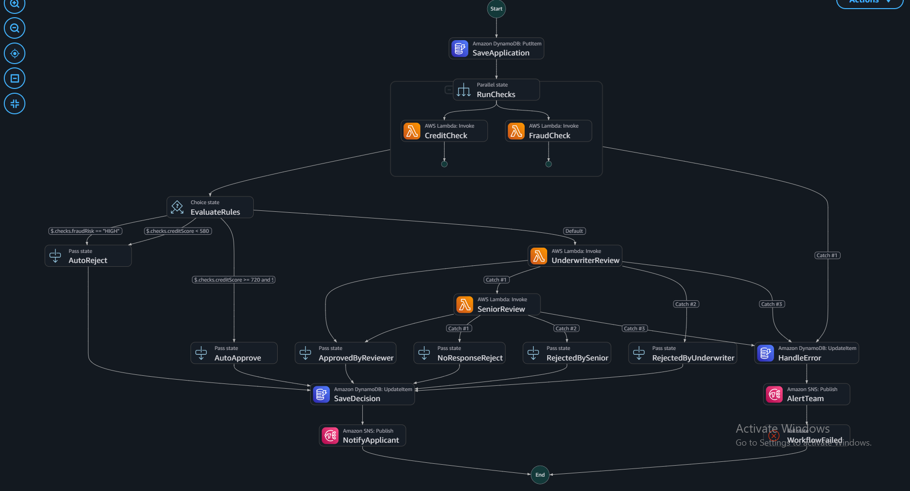
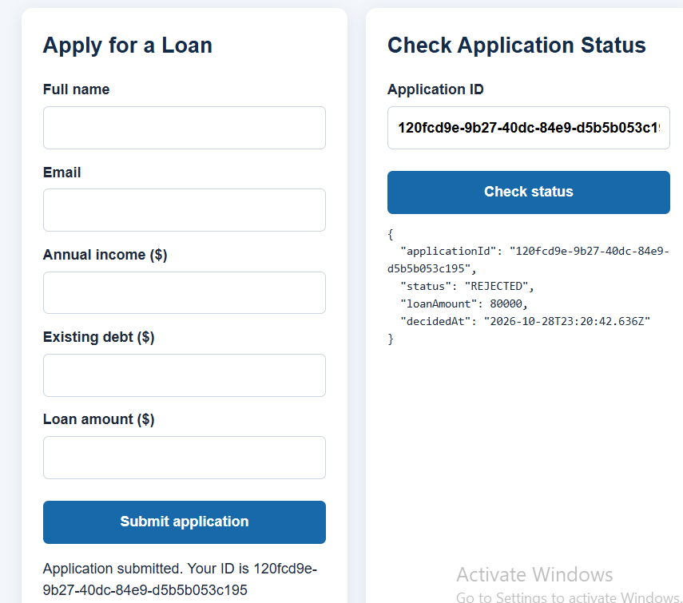
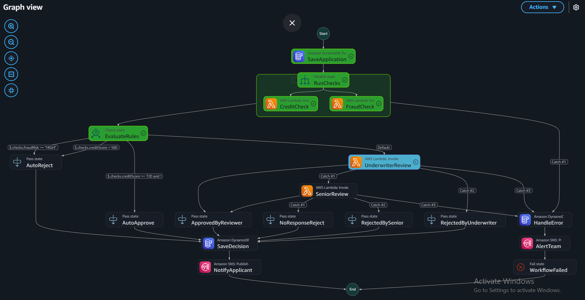
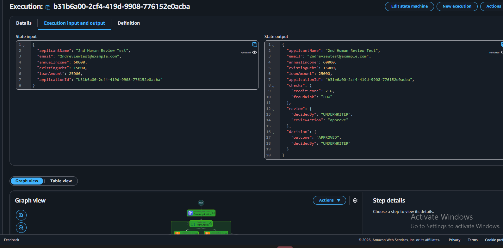
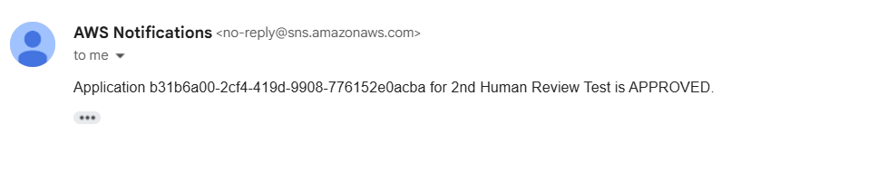
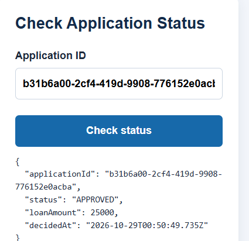
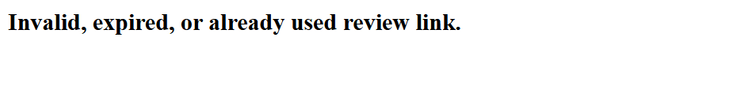

# AWS Loan Approval Workflow

An educational serverless loan-application workflow built on AWS. The system accepts applications through an API, stores application data, runs credit and fraud checks in parallel, makes rule-based decisions, routes uncertain applications to human review, and sends decision notifications.

> **Educational demonstration only.** This project is not a real lending service and must not be used to make actual credit decisions. The credit score and fraud checks are simplified demonstration logic, not a validated credit model.

## Architecture

The implemented workflow uses these AWS services:

- **Amazon S3** — static frontend hosting for the application form and status lookup.
- **Amazon API Gateway (HTTP API)** — exposes application submission, status lookup, and review callback routes.
- **AWS Lambda** — application submission, credit check, fraud check, review request, review callback, and application status functions.
- **AWS Step Functions (Standard)** — orchestrates the workflow, parallel checks, rule evaluation, human review, decision persistence, and error handling.
- **Amazon DynamoDB** — stores application records and workflow state in the `LoanApplications` table.
- **Amazon SNS** — sends review requests and final decision notifications.

Region used in the implementation: `us-east-2` (US East, Ohio).

## Workflow

1. The frontend submits an application through `POST /applications`.
2. API Gateway invokes `SubmitApplication`, which starts `LoanApprovalWorkflow`.
3. The workflow saves the application record to DynamoDB.
4. `CreditCheck` and `FraudCheck` run in parallel.
5. `EvaluateRules` routes an application to automatic approval, automatic rejection, or human review based on the configured demo rules.
6. The human-review branch sends a review request through SNS and waits for a callback from the `/review` route.
7. The workflow saves the final decision and sends a notification through SNS.
8. The frontend queries `GET /applications/{applicationId}` to retrieve the public status fields.

## API routes

| Method | Route | Purpose |
|---|---|---|
| `POST` | `/applications` | Submit an application and start the workflow |
| `GET` | `/applications/{applicationId}` | Retrieve the application status |
| `GET` | `/review` | Process a human-review action using a one-time review token |

The API invoke URL used during testing was:

`https://twigolxkq4.execute-api.us-east-2.amazonaws.com`

## AWS resources

| Resource | Name / purpose |
|---|---|
| Step Functions state machine | `LoanApprovalWorkflow` |
| DynamoDB table | `LoanApplications` |
| SNS topic | `ReviewRequestsTopic` |
| SNS topic | `DecisionsTopic` |
| API Gateway HTTP API | `LoanApprovalAPI` |
| Lambda | `SubmitApplication` |
| Lambda | `GetApplication` |
| Lambda | `CreditCheck` |
| Lambda | `FraudCheck` |
| Lambda | `RequestReview` |
| Lambda | `ReviewCallback` |

The frontend is hosted in the S3 bucket created for this project. Before publishing, review the bucket policy and ensure only intended static website files are public.

## Security considerations

- The review links contain one-time tokens. Treat them as confidential
- The review callback stores a token-consumed timestamp and removes the active review token when a review is submitted.
- The status endpoint should return only fields intended for public status lookup. It currently does not authenticate the requester, so anyone who knows an application ID may be able to query its status. Add appropriate authentication/authorization before production use.
- Query-string tokens may be present in browser history, email, and logs. A production system should use authenticated reviewers and a carefully designed review interface.
- The callback consumes the token before sending the Step Functions task response. If the callback operation fails after token consumption, manual recovery may be required.
- Use least-privilege IAM policies, avoid wildcard permissions where practical, and never commit AWS credentials, task tokens, review tokens, real applicant data, or unredacted environment files.

## Live Demo

**[Open the Loan Approval Application](https://loan-approval-frontend-558766951343-us-east-2-an.s3.us-east-2.amazonaws.com/index.html)**

The frontend is hosted on Amazon S3 and communicates with Amazon API Gateway to submit applications and retrieve application status.

> **Note:** This is an educational demonstration. Credit and fraud checks use simplified rules and must not be used for real lending decisions.

## Architecture

The application uses AWS serverless services to process loan applications, evaluate credit and fraud checks, route uncertain applications for human review, and notify users of the final decision.

## Screenshots and Test Evidence

### Automatic rejection

### Human review in progress

### Human-review approval

### Decision notification

### Application status response

### Review-link replay protection

Observed test outcomes:

- **Automatic approval:** a successful execution returned an `APPROVED` decision with `decidedBy: SYSTEM`.
- **Automatic rejection:** a successful test application returned `REJECTED`, and an SNS decision email was received.
- **Human-review waiting state:** a new application reached the underwriter review task and remained running while awaiting a decision.
- **Human approval:** the review callback returned a recorded decision; the workflow resumed, persisted `APPROVED`, recorded `decidedBy: UNDERWRITER`, and sent an SNS notification.
- **One-time review token replay:** a reused review link returned an invalid/expired/already-used message.
- **Status API:** the response showed only `applicationId`, `status`, `loanAmount`, and `decidedAt`, rather than task/review tokens.

